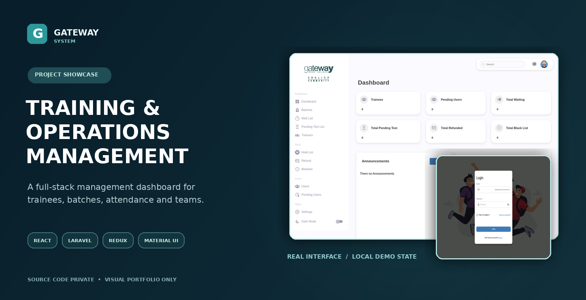
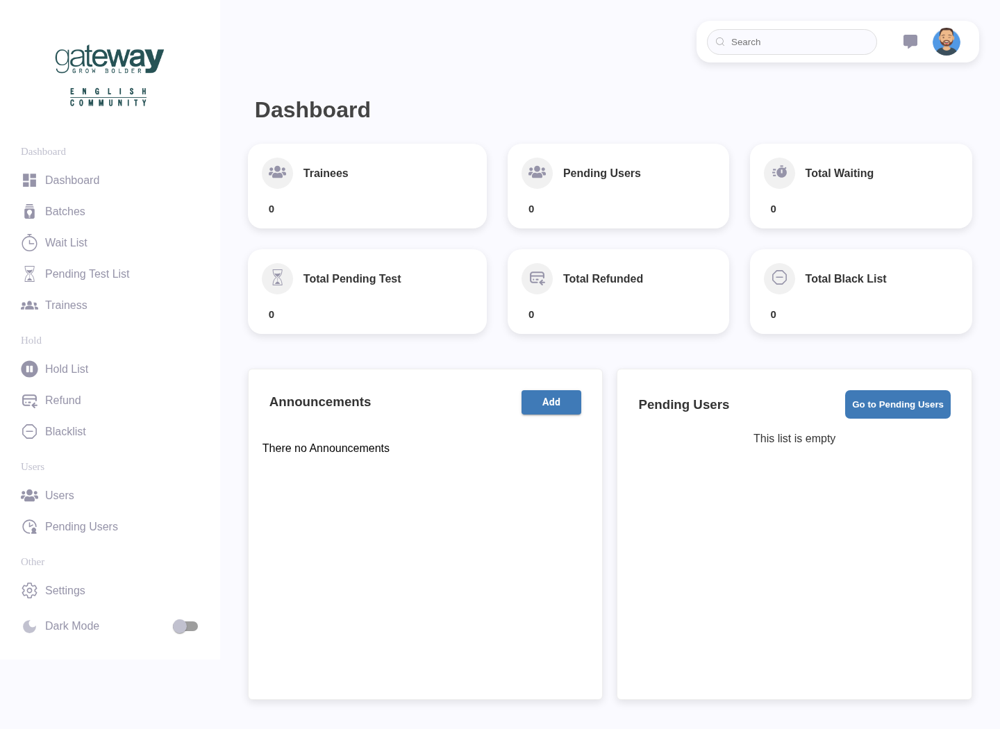
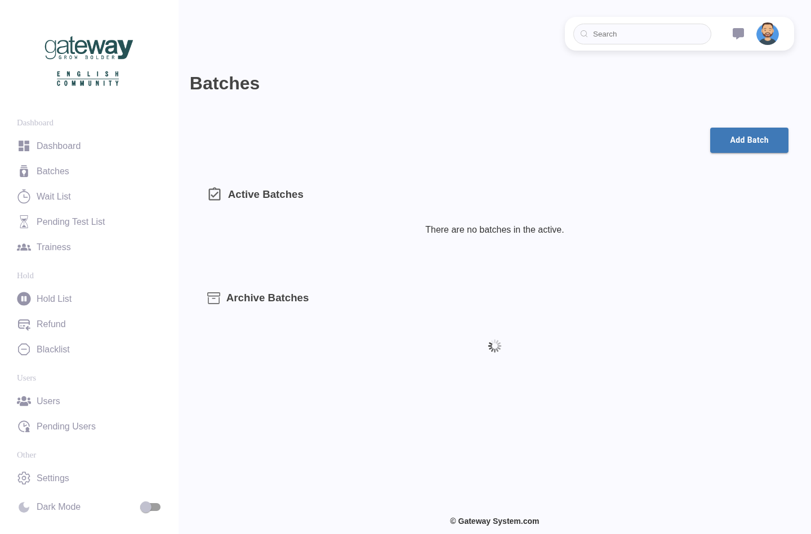
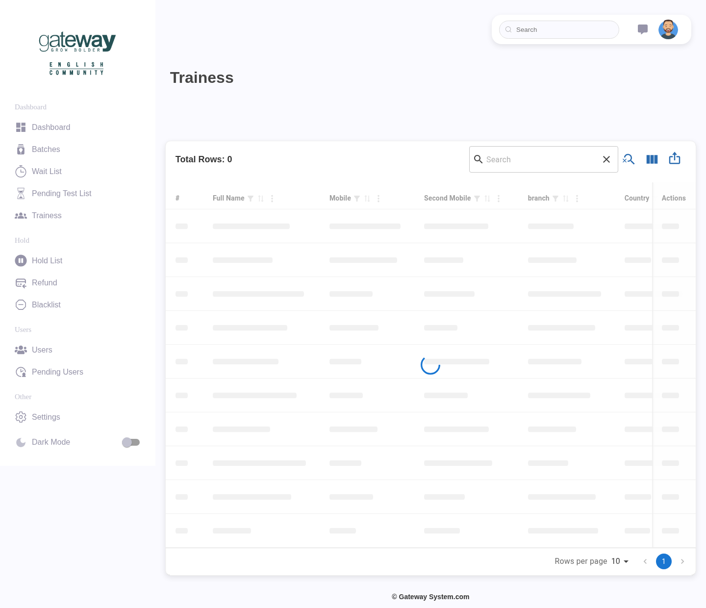
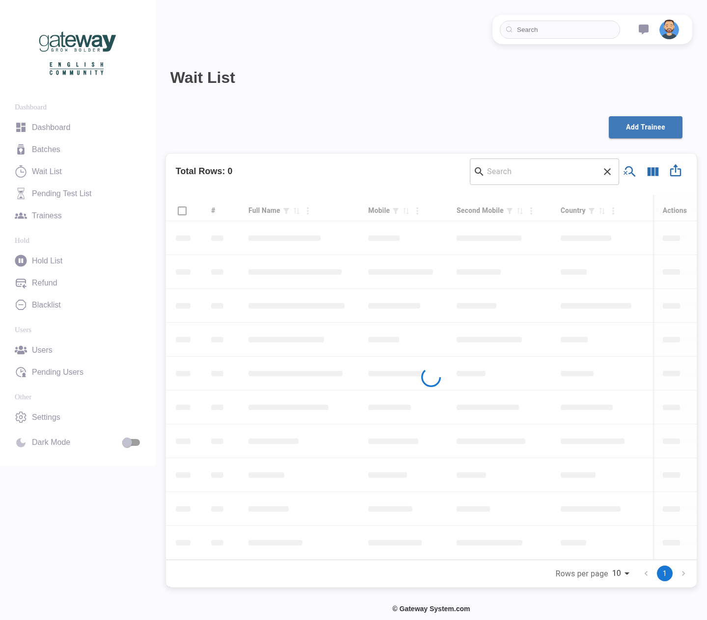
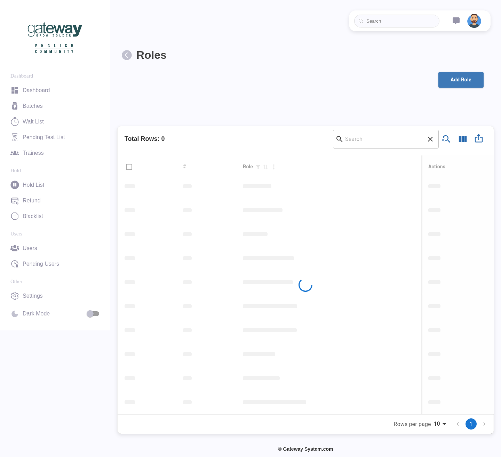
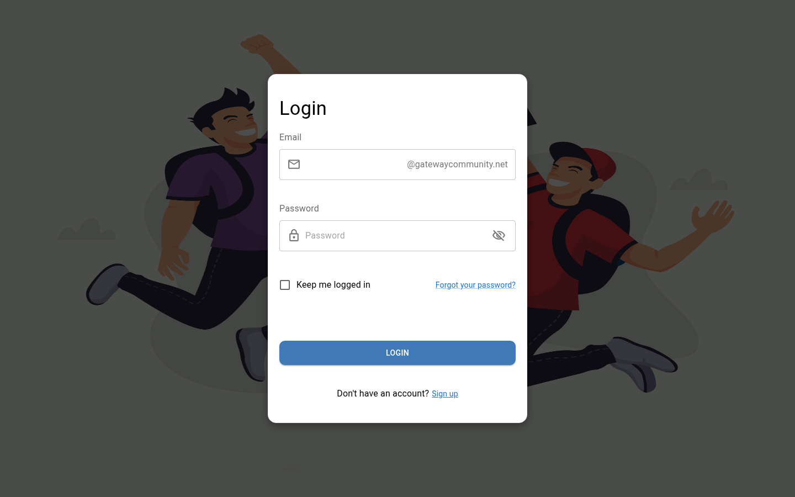
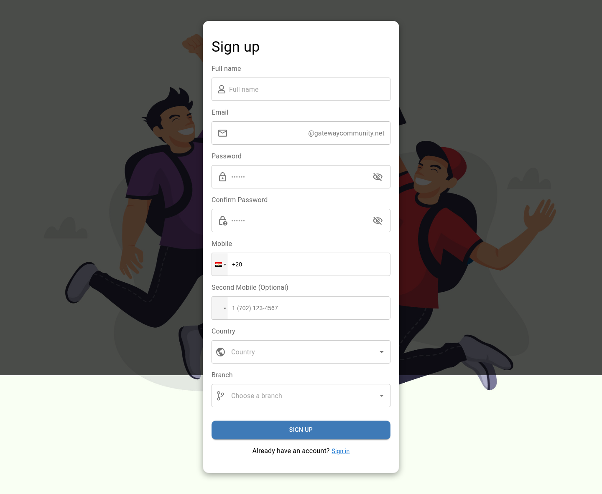
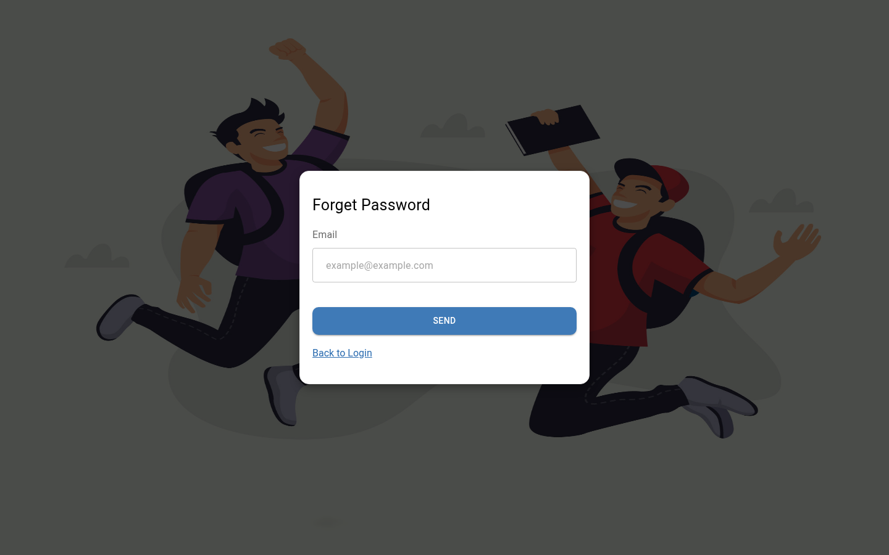
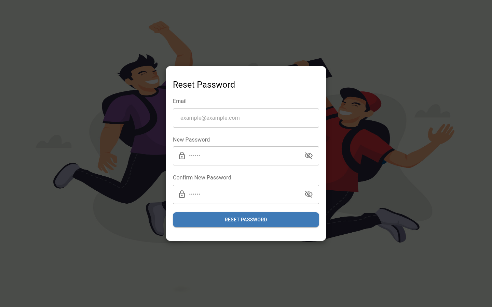

# Gateway System

**A full-stack training and community management platform.**

## Overview

**Gateway System** is an administrative web application designed to coordinate training and community operations. The available code includes authentication, a management dashboard, trainee records, training batches and classes, attendance, branch administration, user permissions, and status-based lists.

This **public repository is a visual project showcase**, not the application source code. The frontend and backend implementations are intentionally kept private.

## Main features

| Module | What it covers |
| --- | --- |
| **Dashboard** | Operational summaries, announcements, and shortcuts to management screens. |
| **Trainees** | Trainee record views and search/filter interfaces. |
| **Batches & Classes** | Training batch and class administration. |
| **Attendance** | Attendance-related pages, including trainer attendance. |
| **Status Workflows** | Wait list, pending tests, hold, refund, and blacklist management. |
| **People & Branches** | User administration, pending users, branch management, and role permissions. |
| **Account Access** | Login, registration, forgotten password, and password reset. |
| **Communication** | Announcements, inbox, and notifications interfaces. |

> **Screenshot note:** Images below were captured from the original React interface in an **isolated local preview**. A mock session was used for protected screens; no live server data or real user records were loaded. Empty tables, loading indicators, and zero counts reflect the preview environment, not operational results.

## Interface gallery

### Dashboard

[View the full dashboard image](screenshots/dashboard-full.png)

### Batches & Trainees

| Batches | Trainees |
| :---: | :---: |
|  |  |

### Workflows & Permissions

| Wait List | Roles |
| :---: | :---: |
|  |  |

### Authentication

| Login | Registration |
| :---: | :---: |
|  |  |

| Password recovery | Password reset |
| :---: | :---: |
|  |  |

## Technology stack

**Frontend:** React 18, Vite 5, JavaScript, Redux Toolkit, React Router, Material UI, Axios.

**Backend:** PHP 8.2+, Laravel 11 API, Laravel Sanctum, Laravel Reverb / WebSocket integration.

**Application structure:** React UI → Laravel API → application data storage, with authentication and permission-aware interface controls. The backend repository also includes database migrations and SQLite development database support.

## Repository access

- **Project source:** Private / not included here.
- **Live application:** No public demo link provided in this showcase.
- **Screenshots:** UI previews only, with no customer or production records.

This repository is intended to demonstrate application scope and user interface design. It does **not** provide a deployable build, software license for the private code, API credentials, or a copy of the project database.

## Contact

Maintained as a portfolio showcase by [@Mohamedshawkeyamar](https://github.com/Mohamedshawkeyamar). For access or project inquiries, contact the repository owner.
